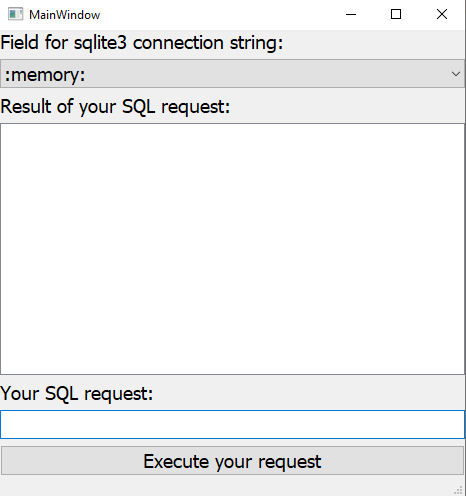
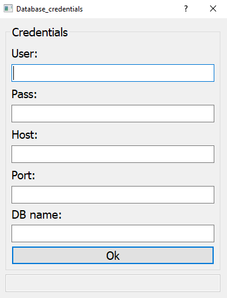

# SQL Query Executor

A lightweight desktop application for executing SQL queries and displaying query results in a tabular interface.

The application is built with Python and PyQt5. It supports SQLite and MySQL databases through Python DB-API 2.0 compatible drivers, without relying on QtSql.

## Features

- **SQL Query Execution** — write and execute SQL queries directly from the application.
- **Tabular Results** — display query results using Qt's `QTableView` and a custom data model.
- **SQLite Support** — connect to SQLite databases using a connection string. The default connection is an in-memory database (`:memory:`).
- **MySQL Support** — connect to remote MySQL databases using PyMySQL.
- **Database Switching** — change the active database connection without restarting the application.
- **Logging** — application logging for tracking operations and diagnosing errors.

## Screenshots

### Main Application



### Initial Database Structure

When the application starts, an in-memory SQLite database is initialized with a sample `stocks` table.


The table contains the following columns:

| Column | Data Type |
|---|---|
| `production_date` | TEXT |
| `status` | TEXT |
| `salesman` | TEXT |
| `real_value` | INTEGER |
| `price` | REAL |

A sample query to retrieve all records:

```sql
SELECT * FROM stocks;
```

### Database Connection Configuration

The application allows users to switch from the default SQLite connection to a remote MySQL database.



Connection parameters are entered through a dedicated dialog.

## Technology Stack

| Technology | Purpose |
|---|---|
| Python 3 | Application logic |
| PyQt5 | Desktop graphical interface |
| SQLite3 | Default database engine |
| PyMySQL | MySQL database connectivity |
| pandas | Tabular data processing |
| Python DB-API 2.0 | Database access abstraction |

**Important:** Database operations are implemented using DB-API 2.0 drivers rather than QtSql, as required by the original assignment.

## Architecture

The application follows a simple separation of responsibilities between the graphical interface, database connectivity, and query execution.

### Project Structure

```text
.
├── README.md
├── db_changer_dialog.py
├── db_connection.py
├── dialog.ui
├── images/
│   ├── Application.png
│   ├── ComponentNames.png
│   ├── credentials.png
│   └── db_memory.png
├── logger.py
├── mainwindow.ui
├── nw.sqlite
├── requirements.txt
├── sql_executor.py
└── task.txt
```

### Main Components

| Component | Responsibility |
|---|---|
| `sql_executor.py` | Main application window and SQL query execution interface. |
| `db_changer_dialog.py` | Dialog for configuring database connection credentials. |
| `db_connection.py` | Database connection management and interaction through DB-API 2.0 drivers. |
| `logger.py` | Application logging functionality. |
| `mainwindow.ui` | Qt Designer UI definition for the main window. |
| `dialog.ui` | Qt Designer UI definition for the database configuration dialog. |
| `nw.sqlite` | SQLite database file. |
| `requirements.txt` | Python dependencies. |
| `task.txt` | Original assignment specification. |

## Getting Started

### Prerequisites

- Python 3
- pip

### Installation

Clone the repository:

```bash
git clone <repository-url>
cd <repository-directory>
```

Install the dependencies:

```bash
pip install -r requirements.txt
```

### Running the Application

Start the application with:

```bash
python sql_executor.py
```

By default, the application connects to an in-memory SQLite database (`:memory:`) and initializes the sample `stocks` table.

You can immediately execute:

```sql
SELECT * FROM stocks;
```

## Database Connectivity

The application supports multiple database backends through their respective DB-API 2.0 drivers.

### SQLite

SQLite is used as the default database backend.

The default connection string is:

```text
:memory:
```

This creates a temporary in-memory database that exists for the lifetime of the connection.

### MySQL

MySQL connectivity is implemented using [PyMySQL](https://pymysql.readthedocs.io/).

Users can switch to a remote MySQL database by selecting the corresponding connection option and providing the required credentials.

## Original Assignment

The application was developed as a solution to a technical assignment focused on building a SQL query execution tool.

The original requirements included:

- Python 3 and PyQt5.
- Database connectivity through Python DB-API 2.0, explicitly excluding QtSql.
- An editable SQLite connection string with `:memory:` as the default value.
- An SQL query input field.
- A button to execute queries.
- A `QTableView` for displaying query results.
- Extensible connection configuration to support additional database engines.

The implementation addresses these requirements while providing additional MySQL connectivity and application logging.

## License

No license has been specified for this project.